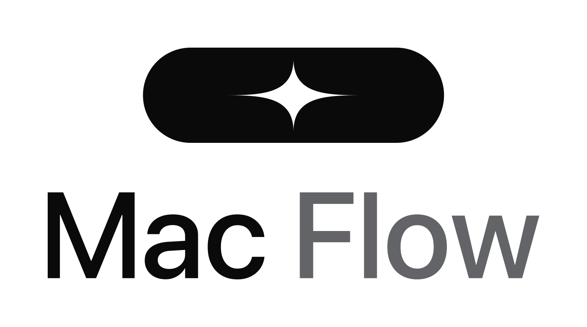
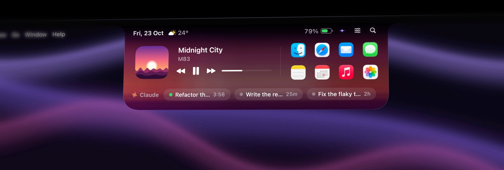
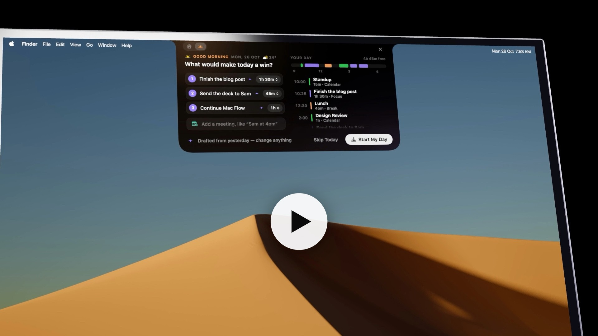
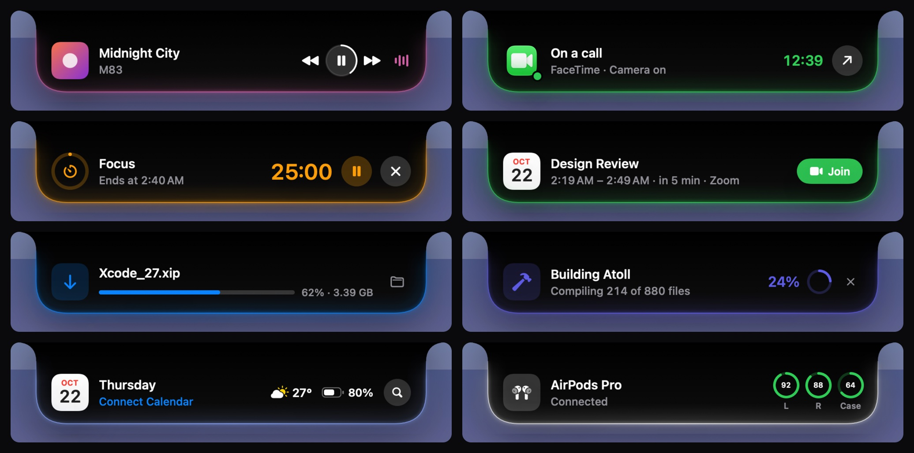
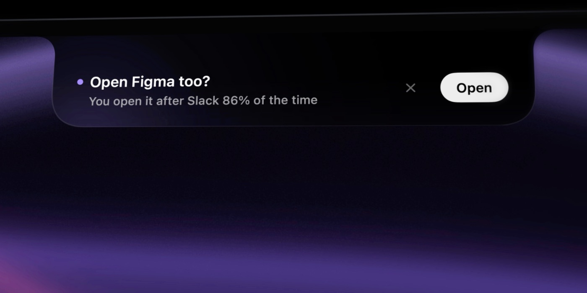
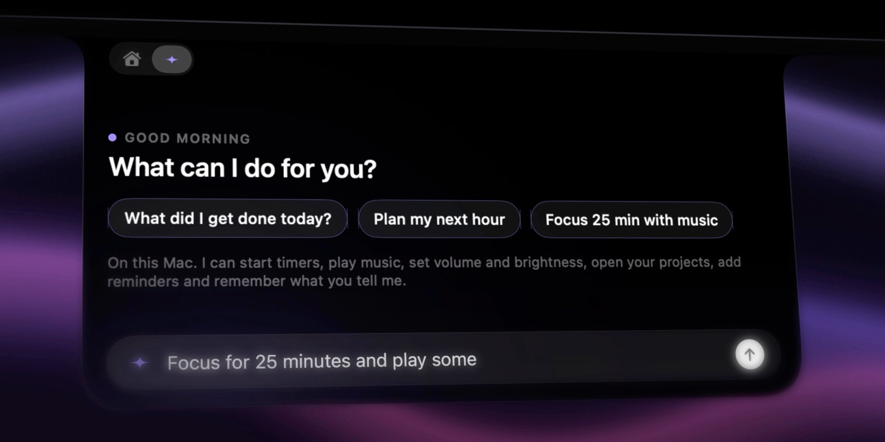
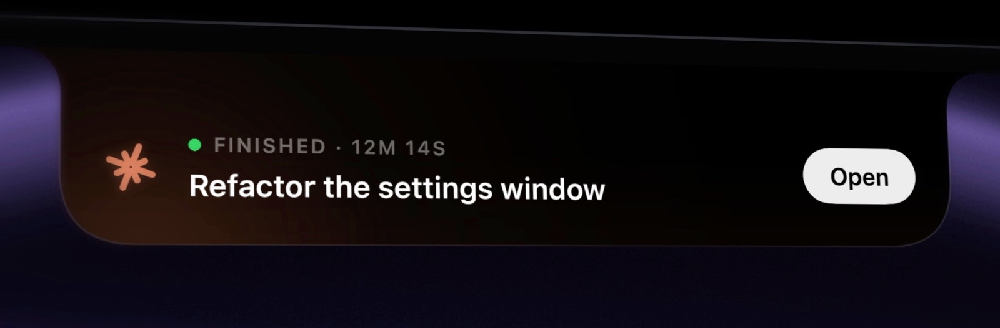
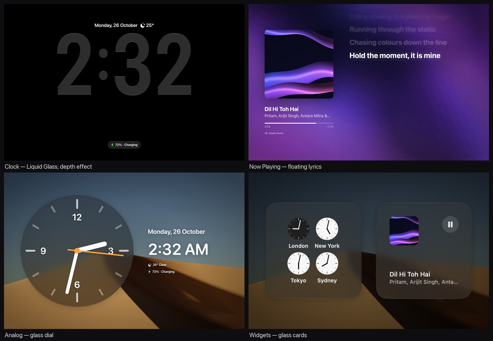
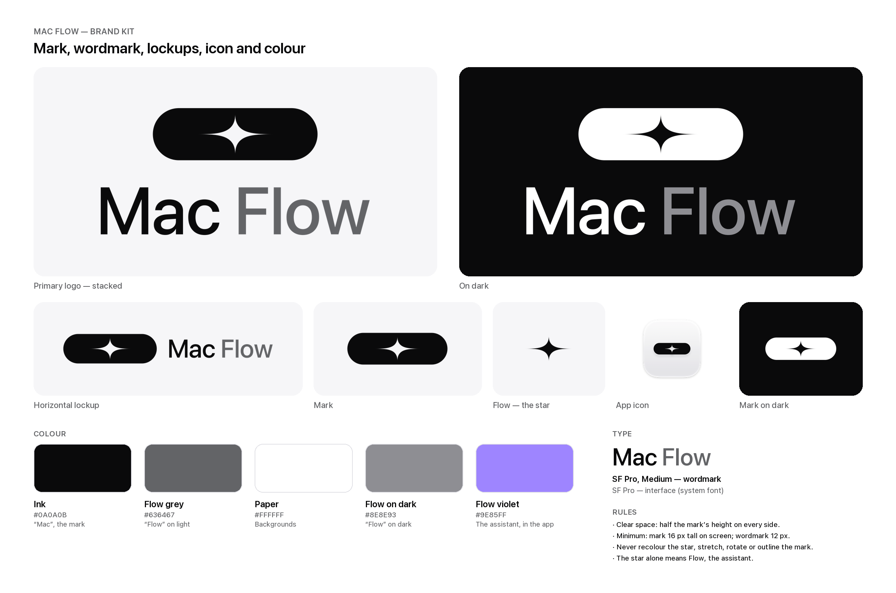

<div align="center">

<picture>
  <source media="(prefers-color-scheme: dark)" srcset="brand/png/macflow-logo-stacked-dark-1575px.png">
  
</picture>

### The notch that thinks.

A Dynamic Island for your Mac's notch, with **Flow**: an assistant that learns how you work<br>
and lives entirely on your Mac.

[](#requirements)
[](Package.swift)
[](Sources/Atoll)
[](scripts/build.sh)
[](#privacy)
[](LICENSE)

[**Releases**](https://github.com/Bmorp/macFLOW/releases) · [Build from source](#build-from-source) · [Design spec](DESIGN.md) · [Brand kit](brand/README.md)

</div>

<br>

<p align="center">
  
</p>

The island grows out of the bezel: its top edge runs wider than its body and curves into it, so it reads as part of the
screen, not a box under it. Whatever is happening right now (a song, a call, a timer, a meeting, a download, your build)
lives beside the notch. Rest the pointer on it and it opens into **one clean row**: a visual, two lines of text, the
controls you need. A thin light in the activity's colour traces its lower edge while it's open.

It moves as one object. The content is laid out at its final size and scales with the shape, growing out of the notch
and shrinking back into it. No blur, no fades, no reflow.

## Watch: one day with Mac Flow

<p align="center">
  <a href="docs/film/macflow-one-day.mp4">
    
  </a>
</p>

<p align="center">
  <sub><b>▶ <a href="docs/film/macflow-one-day.mp4">Watch the film</a></b> · 70 s · 1080p, with sound · every frame of the UI is the real app ·
  how it was made: <a href="promo/v3/REVIEW.md">promo/v3</a></sub>
</p>

From 7:58 AM to midnight: the plan Flow drafted overnight, the room that sets itself, what you copy and what Claude
finishes, the meeting and its notes, your day drawn as a ring, Rewind, and StandBy singing you out.

---

## Live Activities

Every feature with a beginning and an end is a Live Activity, with a compact, a minimal (split bubble) and an expanded
presentation. When two are live at once, the island splits and the second one detaches into its own bubble.

<p align="center">
  
</p>

**Now Playing** (Music and Spotify in full; any other app playing sound, by icon) · **Calls** (FaceTime, Zoom, Teams,
Meet in a browser, detected from microphone and camera use) · **Timer** · **Meeting** with one-click Join ·
**Download** · **Shelf** · **Keep Awake** · **your own builds and scripts**

## Meet Flow

<table>
  <tr>
    <td width="50%"></td>
    <td width="50%"></td>
  </tr>
  <tr>
    <td align="center"><sub>It speaks up at the right moment.</sub></td>
    <td align="center"><sub>Or just ask.</sub></td>
  </tr>
</table>

Flow is the star in the mark. It's an on-device engine that watches how you work, at the depth you choose, and turns
that into one useful suggestion at a time.

- **Learns at your depth**: Essentials, Context or Everything. Everything reads the window you're in with Apple's
  Vision framework, on-device, and never looks at password managers or private windows.
- **Understands what you're doing**: coding, writing, designing, in a meeting. It also learns your projects, your
  routines and the music you like while you work.
- **Speaks up once, at the right moment**, ranked by what you accepted before: resume your project, wrap up before a
  meeting, take a break after a long stretch, protect your focus, help with a copied error, a recap of your day.
- **Asks while it learns** ("Do you like music while coding?") and **does it for you**: timers, music, volume,
  brightness, reminders, opening your project, joining the meeting.
- **Answers about your day** ("What did I get done today?"). Press and hold the notch to talk to it.
- **Thinks with Apple's on-device model** (macOS 26 and later). Nothing leaves your Mac.

### Flow through your day

- **Plan your day.** The first time you open your Mac each morning, the island offers a plan: three priorities, drafted
  from what you left unfinished and your meetings' action items, placed around your calendar and in your sharpest hours.
- **Set the room.** "Up next" reopens the apps, documents and music from the last time you did that work, hides the rest,
  and starts a quiet timer. While a focus block runs, everything but your window dims.
- **Flow Lens.** Copy something with an obvious next step (a time and a place, a long passage, a question) and the notch
  offers it: Add to Calendar, Summarize, Draft Reply, Translate. All on this Mac.
- **Meeting notes.** Join from the island; if you turn on notes, it transcribes on this Mac, then writes up the call and
  carries the action items into tomorrow's plan.
- **Your day, and Rewind.** A ring of everything you worked on, meetings and music; and a scrubber that takes you back to
  what you were doing at 3, with the apps and documents one click away.

## Claude, live in the notch

<p align="center">
  
</p>

Mac Flow tracks every Claude Code session on your Mac. The island shows what Claude is working on and for how long,
pops up when Claude **needs you** or **finishes** a long task, and the home lists your recent sessions. It reads only
the session status files in `~/.claude/sessions`, never your conversations.

Type a question in Search (<kbd>⌥</kbd> <kbd>Space</kbd>) and Claude's answer streams into the island. You can also
explain, summarize, translate or fix what you just copied. This uses the Claude Code bundled with the Claude app,
signed in to your account, with every tool turned off.

## StandBy

<p align="center">
  
</p>

After five idle minutes on power (or <kbd>⌃</kbd> <kbd>⌘</kbd> <kbd>S</kbd>), the display becomes a clock in Liquid
Glass over original 4K wallpapers rendered on the GPU, two smart stacks of glass widgets, or Now Playing on the album's
moving colours with **time-synced lyrics**. Red night mode runs 10 PM to 6 AM, the layout drifts against burn-in, and
StandBy stays out of the way of video, presentations and calls.

## Everything it does

| | |
|---|---|
| **Live Activities** | Now Playing, Calls, Timer, Meeting with Join, Download, Shelf, Keep Awake, and your own tools. Each has a compact, a minimal and a one-row expanded presentation |
| **Flow** | Suggestions, questions while it learns, actions, answers about your day, hold-to-talk, and meeting notes transcribed on this Mac |
| **Claude** | Live Claude Code sessions in the island, "needs you" and "finished" alerts, recent sessions on the home |
| **Ask Claude** | Questions from Search, or explain, summarize, translate or fix what you copied |
| **Your tools** | Builds, deploys and scripts can show progress: `atoll progress "Building" --progress 24`, then `atoll done "Build succeeded"`. Display only: a link can show text, never run anything |
| **Alerts** | Volume, charging and low battery, song changes, AirPods with battery rings, camera and microphone in use, download finished, timer finished, meeting starting |
| **Home** | With nothing live (or only music), hovering opens your player and eight apps, with date, weather, battery and search beside the notch |
| **Search** (<kbd>⌥</kbd> <kbd>Space</kbd>) | Apps, files, actions, Shortcuts, System Settings, clipboard history, answers (`26.2 mi in km`, `$40 to €`, `time in Tokyo`, `15% of 240`), `remind me to … at 5pm` (creates a real reminder), `timer 10` |
| **Drop** | Drag files to the notch and pick a target: Hold on Shelf, or AirDrop |
| **Mirror** | A camera preview before a call |

**Extras**, off until you turn them on in Settings:

| | |
|---|---|
| **Desktop Widgets** | Now Playing, Up Next (with Join), Weather, World Clock, Batteries, Focus Timer, Reminders (check off in place), System, Shortcuts and Shelf, in small, medium and large. Full colour on the desktop, quieter monochrome while you work in an app. They snap to each other with a haptic and never overlap |
| **StandBy** (<kbd>⌃</kbd> <kbd>⌘</kbd> <kbd>S</kbd>) | Clock, smart stacks and Now Playing with lyrics, as above |
| **Dock Companion** | A glass handle above the Dock while your pointer is on it: what's live, recent files with thumbnails, your folders and Mac Flow's actions, magnifying like the Dock |
| **Dock drop tray** | Drag files toward the Dock: Hold on Shelf, AirDrop, Share or Compress |
| **Live Dock icon** | The icon shows a running timer or the current album, and its menu holds every action |

**Input.** Hover or click to open. Two-finger swipe down to open, sideways to move between activities, up to close.
Scroll over Now Playing to change the volume. Everything is also reachable from the menu bar and the keyboard.

**Haptics** only where Apple documents a meaning: the island settling open, a scrubber reaching either end, a gesture
crossing its commit point, and a drop being accepted.

## Install

Download the latest DMG from [Releases](https://github.com/Bmorp/macFLOW/releases), open it and drag **Mac Flow** to
Applications.

The DMG is signed with Hardened Runtime but not notarized yet. The first time you open it, macOS may say it can't check
the app: open **System Settings › Privacy & Security** and click **Open Anyway**.

**Updates arrive on their own.** Mac Flow checks for a new release at launch and once a day. When one is out, the island
offers it once, and the menu bar menu and **Settings › About** keep offering it. **Update** downloads it, verifies it,
swaps it in place and relaunches. Turn the check off in **Settings › About**, or check any time from the menu.

### Requirements

- macOS 14 Sonoma or later, on Apple silicon or Intel
- Flow's thinking uses Apple's on-device model, which needs macOS 26 or later; everything else works from macOS 14
- A Mac with a notch looks best, but the island works on any display

## Build from source

You need Xcode 26 or later (for the Liquid Glass icon and the weak-linked FoundationModels framework).

```bash
git clone https://github.com/Bmorp/macFLOW.git
cd macFLOW
./scripts/build.sh            # tests → universal build → icon → Hardened Runtime → DMG in dist/
```

| Command | What it does |
|---|---|
| `./scripts/build.sh` | Builds `dist/Mac Flow.app`, `dist/MacFlow-<version>.dmg` and the `.zip` the updater installs |
| `SKIP_DMG=1 ./scripts/build.sh` | App bundle and zip only |
| `VERSION=8.1.3 ./scripts/build.sh` | Builds as that version |
| `SIGN_ID="Developer ID Application: …" ./scripts/build.sh` | Signs for notarization |
| `swift test` | Runs the Swift Testing suite: calculator, conversions, parsing, clipboard, search, widget layout, activity links, lyrics, Brain |

Without a Developer ID, `build.sh` signs with a self-signed **Mac Flow Local** certificate if your login keychain has
one, so macOS keeps Accessibility, Microphone and the rest granted across rebuilds. Make it once in **Keychain Access ›
Certificate Assistant › Create a Certificate…** (Identity Type *Self-Signed Root*, Certificate Type *Code Signing*).

The app icon is an Icon Composer document (`Resources/AppIcon.icon`) compiled by `actool`, so macOS renders it with
Liquid Glass and generates the dark and tinted appearances itself.

### Debug renders

Every presentation can be rendered offscreen with demo data. These never touch your stores.

```bash
swift build && "$(swift build --show-bin-path)/Atoll" --snapshot /tmp/atoll-snaps    # the island
"$(swift build --show-bin-path)/Atoll" --surfaces /tmp/atoll-surfaces                # widgets, StandBy, Dock, gallery
"$(swift build --show-bin-path)/Atoll" --motion /tmp/atoll-motion                    # every transition, frame by frame
"$(swift build --show-bin-path)/Atoll" --standby /tmp/atoll-standby                  # every StandBy page
```

`--motion` draws each transition at fixed moments (0–800 ms) with the same springs, exit timing and reveal stagger as
the live app, so clipping, drift or squashing shows up in review rather than on someone's screen.

**Performance.** `swift build -c release -Xswiftc -DATOLL_PROBE && .build/release/Atoll --perf /tmp/atoll-perf` drives
the real island through every transition and prints missed display frames per transition.

**Wallpapers.** StandBy's wallpapers are Metal renders. To re-render one from the repo root:

```bash
swiftc -O scripts/wallpapers/render.swift -o /tmp/wallrender && /tmp/wallrender dunes   # → Resources/Wallpapers/dunes.heic
```

### Show your own activities

The app ships a small command-line helper:

```bash
ln -s "/Applications/Mac Flow.app/Contents/Resources/atoll" /usr/local/bin/atoll
atoll progress "Building" --detail "My App" --progress 24 --symbol hammer.fill --tint indigo
atoll done "Build succeeded"        # or: atoll fail "Tests failed", atoll clear
```

Under the hood it's a URL: `open -g "atoll://progress?title=Building&progress=24"` (`macflow://` works too).

## Releases

Every push to `main` that changes the app runs [`.github/workflows/release.yml`](.github/workflows/release.yml): it
tests, builds a universal app, and publishes a GitHub Release with the DMG, a zip of the app and the zip's SHA-256.
Installed copies pick it up within a day.

- **Versions.** `VERSION` in [`scripts/build.sh`](scripts/build.sh) is the base. Its first release uses it as is, and each
  release after bumps the last number (8.1.0, 8.1.1, 8.1.2…). Raise the base for a bigger release.
- **Skipping.** Put `[skip ci]` in a commit message to push without releasing. Changes to docs, the brand kit or the
  promo never trigger a release.
- **What the updater accepts.** The latest non-draft, non-prerelease release with a `.zip` and a matching
  `.zip.sha256`. Before swapping, it checks the checksum, that the app inside is Mac Flow at the promised version, and
  that its signature is valid and, when the installed copy is signed with a certificate, made with the same one.

### Signing releases with your certificate

Without a certificate, CI signs builds ad hoc, and macOS treats each update as a new app: people have to grant
Accessibility, Microphone and the rest again. Sign every release with one certificate instead:

1. In **Keychain Access › Certificate Assistant › Create a Certificate…**, make **Mac Flow Local** (Identity Type
   *Self-Signed Root*, Certificate Type *Code Signing*). `build.sh` also uses it for your local builds.
2. In **Keychain Access › My Certificates**, Control-click it, choose **Export**, and save `MacFlow.p12` with a password.
3. Add it to the repository's secrets, then delete the file:

   ```bash
   base64 -i MacFlow.p12 | gh secret set MACOS_CERT_P12 --repo Bmorp/macFLOW
   ```

   ```bash
   gh secret set MACOS_CERT_PASSWORD --repo Bmorp/macFLOW
   ```

Keep the certificate backed up. Once people run a build signed with it, the updater only installs builds signed with the
same certificate.

## Project

The Swift package and its executable are still named **Atoll**, the project's working name; the shipped app is
**Mac Flow**.

```
Sources/Atoll/
  App/            entry point, delegate, menus, menu bar extra, windows, snapshot harness
  Brain/          Flow: sensing, understanding, habits, memory, suggestions, speech, on-device model
  Core/           preferences, haptics, notch geometry, global shortcut
  DesignSystem/   tokens (colour, type, space, radii, motion), brand mark and components
  Island/         panel, state model, input controller, manager, notch shape, liquid split
  Activities/     ActivityCenter (priority) and each activity's compact / minimal / expanded views
  Surfaces/       Glance, Alerts, Search, Drop, Mirror
  Widgets/        model and layout store, container chrome, the ten widgets, desktop windows, gallery
  StandBy/        idle detection and full-screen ambient pages
  Dock/           Dock geometry, companion bar, drop tray, live Dock icon
  Services/       media, audio activity, volume, calendar, reminders, battery, downloads,
                  Bluetooth, weather, clipboard, shelf, apps, files, conversions, Shortcuts, updates
  Settings/       settings window (Overview, General, Brain, Live Activities, Search, Widgets, StandBy, Dock), welcome
Resources/        Info.plist, entitlements, privacy manifest, AppIcon.icon, StandBy wallpapers
Tests/AtollTests/ Swift Testing suite
scripts/          build, DMG art, brand kit, wallpaper renderer, the atoll helper
brand/            logos, mark, star, wordmark, app icon (SVG · PDF · PNG)
docs/             screenshots and an example MDM profile
promo/            the launch films' source (HyperFrames)
.github/          the release workflow
```

The full design rationale, tokens and citations to Apple's Human Interface Guidelines are in **[DESIGN.md](DESIGN.md)**.

## Privacy

Nothing is requested at launch. Each permission is asked the first time its feature is used: Calendars, Reminders,
Camera, Bluetooth, the Downloads folder, Location (or type a city), Microphone and Speech Recognition (talking to Flow,
meeting notes you start), Screen Recording (only at Flow's Everything depth), Accessibility (to control any player and
paste clips), and Automation for Music and Spotify.

Flow's observations, memory and model run on this Mac. Audio is transcribed on-device and never saved or sent.
Network use is limited to Open-Meteo for weather and ECB rates via frankfurter for currency, both without an account;
and, while StandBy shows Now Playing, LRCLIB (lrclib.net) for lyrics, asked with the song's title, artist, album and
length only (**Settings › StandBy › Show Lyrics** turns it off); and GitHub, at launch and once a day, to check for a
new release, sending nothing about you (**Settings › About** turns it off). The privacy manifest declares no tracking
and no data collection.

### Managed Macs

Mac Flow reads its settings through standard preferences, so an MDM can set them.
[docs/Atoll.mobileconfig](docs/Atoll.mobileconfig) is an example profile (domain `app.atoll.Atoll`) covering the common
switches.

## Known limits

- Track titles and artwork for apps other than Music and Spotify would need Apple's private MediaRemote API, which
  recent macOS restricts to Apple's own processes. Mac Flow detects those apps through public CoreAudio APIs and
  controls them with media keys.
- The Dock's exact width isn't public, so the companion centres itself over the Dock's edge rather than its icons.
- Release builds aren't notarized yet, because that needs an Apple Developer ID. With one, run
  `SIGN_ID="Developer ID Application: …" ./scripts/build.sh`, then notarize and staple the DMG.
- The updater can only replace Mac Flow where you can write: an app in **Applications** installed by your own account.
  Otherwise it says so and points to the download.
- Turn-by-turn navigation, answering phone calls and Siri have no public macOS APIs, so Mac Flow doesn't fake them.

## Brand

<p align="center">
  
</p>

The mark is the island, a 3.156 : 1 stadium, with a four-point star cut through it. **The star alone is Flow.** Logos,
the mark, the wordmark, avatars and the app icon are in [`brand/`](brand/README.md) as SVG, PDF and PNG, generated from
one definition shared with the app (`DesignSystem/Brand.swift`).

| Ink | Flow grey | Paper | Flow on dark | Flow violet |
|:---:|:---:|:---:|:---:|:---:|
| `#0A0A0B` | `#636467` | `#FFFFFF` | `#8E8E93` | `#9E85FF` |

## Contributing

Issues and pull requests are welcome. Before you open a PR:

1. Read [DESIGN.md](DESIGN.md). Every visual and motion decision there is deliberate and cited.
2. Run `swift test` and make sure it passes.
3. For UI changes, attach before and after renders from `--snapshot` or `--motion`.

## License

Mac Flow is released under the [MIT License](LICENSE).

Mac, macOS, Dynamic Island, SF Pro and Liquid Glass are trademarks of Apple Inc. Claude is a trademark of Anthropic.
Mac Flow is an independent project and isn't affiliated with or endorsed by either company.
